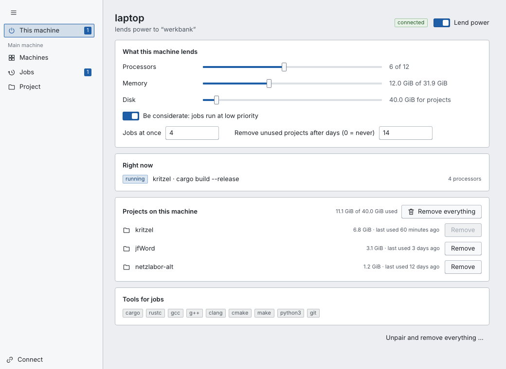
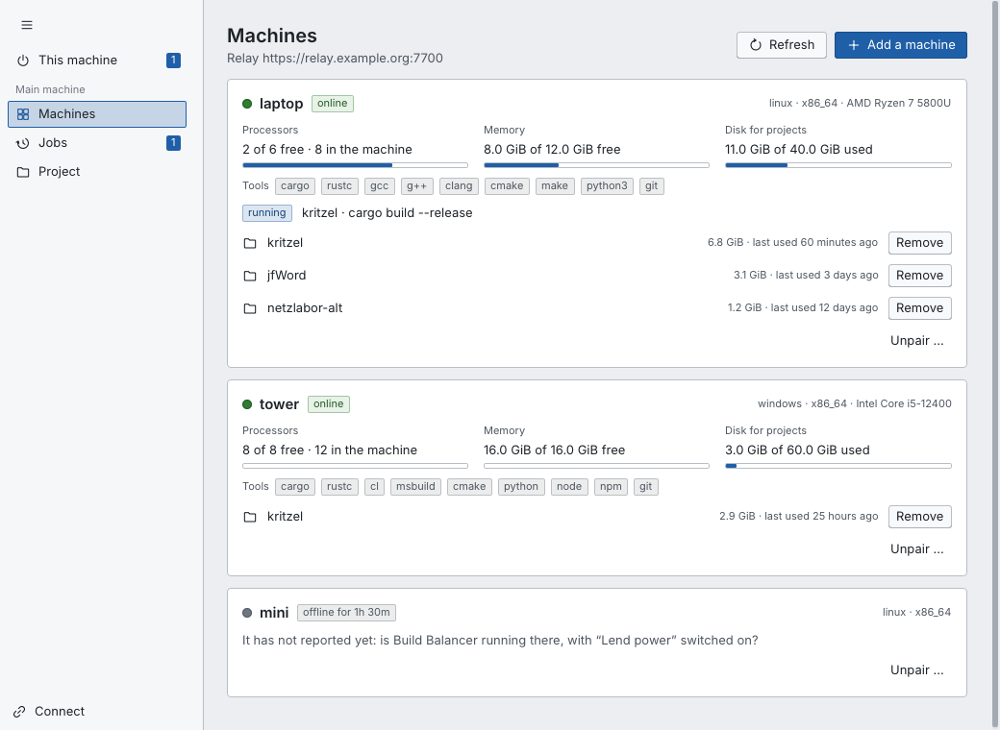

# Build Balancer

**Spread builds over the machines you own.**

You have one main machine and a build that takes too long -- and a laptop, an old tower, a
Linux box that sit idle. Build Balancer lets the main machine hand work to them: it sends a
project's files to a worker, runs a command there and brings the results back. Which machine
gets which piece of work is decided on the main machine, by you or by an AI agent that sees
what every worker lends and is doing.

```
   main machine                         relay                          workers
  ┌────────────┐                    ┌──────────┐                   ┌──────────────┐
  │ bb         │ ── sealed jobs ──▶ │ bb-relay │ ◀── long poll ─── │ bb-worker    │ laptop (Linux)
  │ (you / an  │ ◀─ sealed logs, ── │ passes   │ ─── sealed job ─▶ │  6 of 8 CPUs │
  │  AI agent) │    results         │ data on  │                   │  12 GiB RAM  │
  └────────────┘                    └──────────┘ ◀──────────────── │ bb-worker    │ tower (Windows)
        every machine connects OUT to the relay; no worker opens a port     └──────────────┘
```

- **Four programs, one file each**, for Windows, Linux and macOS: `bb` (main machine),
  `bb-worker` (machines that lend power), `bb-relay` (the one address everything can reach)
  and `BuildBalancer`, the [desktop app](#the-desktop-app) that does what `bb-worker` and
  the everyday part of `bb` do, with a window.
- **Any build system.** A job is a command: `cargo build`, `make`, `python build.py`, a test
  suite. Nothing wraps your compiler.
- **Incremental.** A worker keeps its copy of the project (and so its own build cache)
  between jobs; only changed files travel, identical content is stored once.
- **The owner of a worker decides what it lends:** how many processors (jobs are pinned to
  them), how much memory (jobs beyond it are ended), how much disk, and whether jobs run at
  low priority so the machine stays usable.
- **Nothing to clean up after.** One click (or one command) removes everything a project
  left on a machine; projects nobody used for two weeks go by themselves.
- **The relay only passes data on.** Sources, logs and results are encrypted between the
  machines; the relay has no key. Pairing is a one-time code.
- **Made for agents.** Every command has `--json`, `bb guide` explains the workflow to an
  agent, and `bb mcp` serves everything as MCP tools.
- **No dependencies** beyond [JFLib](https://jflib.org): the programs are `no_std` Rust,
  link no C runtime and need nothing installed.

Status: version 0.1 -- it works end to end on Windows and Linux (see [What is tested](#what-is-tested)),
it is young, and the interface may still change. macOS is new: the code is there and the CI
builds and tests it on a Mac, but nobody has used it on one yet.

## Quick start

**1. The relay** -- on a machine every device can reach (a small server, or simply the main
machine when everything is in one network). Copy `bb-relay` there and start it:

```sh
./bb-relay
```

It makes its data folder, its certificate and a setup key, and prints the two commands for
the next steps. `bb-relay service install` keeps it running as a system service.

**2. The main machine** -- run the line the relay printed:

```sh
bb setup relay.example.org:7700 <setup key>
```

**3. Every worker** -- on the main machine:

```sh
bb pair
```

prints a command with a one-time code; run it on the machine that should lend its power,
then start the worker:

```sh
bb-worker join relay.example.org:7700 K7QF-2M9X-PD4T
bb-worker run                 # or: bb-worker service install
```

`bb workers` on the main machine now shows it: what it lends, what is idle, which build
tools it has.

**4. A project** -- in your project's folder:

```sh
bb init                                       # writes buildbalancer.ini, nothing else
bb run -- cargo build --release               # runs on the least busy worker that fits
bb run -w laptop --out "target/release/app" -- cargo build --release     # ... and brings the result back
```

## The desktop app



`BuildBalancer` is one window for a machine that lends its power, for the main machine, or
for both. On a machine that should help, it is all you need:

1. Start it and choose **This machine lends power**.
2. Enter the relay's address and the code from the main machine (there: **Machines > Add a
   machine**, or `bb pair`) -- or paste the whole `bb-worker join ...` line into the first field.
3. Done. The switch **Lend power** turns the worker on and off; the sliders set how many
   processors, how much memory and how much disk jobs may use, and take effect at once.

Under **Projects on this machine** every project that has files here is listed with its size.
**Remove** deletes everything of one -- its files, the build output that grew next to them,
the logs of its jobs -- and **Remove everything** does it for all. Nothing breaks by that:
the next job sends the project again. **Unpair and remove everything** leaves the machine as
if Build Balancer had never run on it.

On the main machine the app shows the workers with what they lend and do (**Machines**, also
with a **Remove** per project and worker), the jobs with their output (**Jobs**), and runs a
project's tasks or a command (**Project**). It works on the same files as `bb`, so jobs an
agent starts through `bb` show up in the window too.



The worker inside the app runs while the window is open. For a machine nobody is logged in
to, use `bb-worker service install` instead. `BuildBalancer --demo` shows the app with
made-up machines and contacts nothing.

## Working with it

```sh
bb workers                          # who is there, what they lend and do, their tools
bb run [options] -- COMMAND ARGS    # send the project, run COMMAND on a worker, wait for it
bb run --sh 'make -j$BB_CPUS && make test'      # a script for the worker's shell
bb task linux-release windows-release           # tasks of buildbalancer.ini, at once
bb jobs / status JOB / logs JOB -f / wait JOB.. / cancel JOB / fetch JOB
bb clean -w laptop / bb clean --all             # remove what workers keep of this project
```

The important options of `bb run`:

| Option | Meaning |
| --- | --- |
| `-w NAME` | this worker; without it the least busy worker that fits `--needs` |
| `--needs "os=linux cpu>=8 ram>=16G tool=cargo tag=gpu"` | what the worker must have |
| `--cpu N`, `--ram 8G` | what the job holds on the worker (default: all processors it lends, so jobs there run one after the other) |
| `--out PATTERN` | files to bring back: a file, a folder, a glob like `build/**/*.exe` (repeatable) |
| `--sh 'SCRIPT'`, `--shell bash` | a shell script instead of a command (`sh` on Linux and macOS, `cmd` on Windows by default). Single quotes keep `$BB_CPUS` for the worker's shell. |
| `--env NAME=VALUE`, `--cwd DIR`, `--timeout 30m` | |
| `--slot NAME` | a separate copy of the project on the worker, so jobs can run side by side |
| `-d` | do not wait; `bb wait JOB`, `bb logs -f JOB` follow later |
| `--no-sync`, `--no-fetch`, `--to DIR` | skip sending files / leave outputs at the relay / write them elsewhere |
| `--json` | one JSON document instead of text (on every command) |

`bb run` exits with the command's own exit code (130 cancelled, 137 ended by a limit, 1 when
it could not run).

### What is sent

Every file of the project folder except what `.gitignore` and `.bbignore` (same syntax)
leave out, and without `.git`. So build output stays at home, and every worker keeps its own.
`buildbalancer.ini` can adjust it:

```ini
[project]
name = myapp
id = p-k7m2x9pq4d          # written by bb init; names the workspace on every worker

[sync]
gitignore = true
git = false                # true: send .git too (builds that read the commit from it)
exclude = docs/ ; *.psd
include = generated/api.rs # ignored by git, but the build needs it

[task.linux-release]
run = cargo build --release
needs = os=linux tool=cargo cpu>=4
outputs = target/release/myapp

[task.tests]
sh = make -j$BB_CPUS && make test
cpu = 8
ram = 8G
timeout = 1h
outputs = reports/*.xml
slot = tests
```

An `include` pattern with a path in it (`generated/api.rs`, `out/**/*.h`, `*/gen/*.rs`) also
reaches into a folder that is ignored as a whole; a bare name (`*.h`) only applies where the
walk goes anyway. Symbolic links are not sent (they rarely mean the same on Windows and Linux).

### What a job sees

It runs in the worker's copy of the project, as the user `bb-worker` runs as, with the
worker's own tools and PATH, plus: `BB_CPUS` (the processors it holds), `BB_RAM_MB`,
`BB_JOB_ID`, `BB_PROJECT`, `BB_WORKSPACE`, `BB_WORKER`; and `CARGO_BUILD_JOBS`,
`CMAKE_BUILD_PARALLEL_LEVEL`, `GOMAXPROCS` set to the same number so those tools do not
start one process per processor of the whole machine.

## What a worker lends

```sh
bb-worker config --cpu 6 --ram 12G --disk 40G --jobs 4 --priority low --tags gpu,fast-disk
bb-worker config                # show
bb-worker tools                 # the build tools jobs can use here
```

A running worker takes changes over within seconds. Shares work too: `--cpu 50%`,
`--ram 50%`, `--disk 50%` (of the free space).

| Limit | How it is held |
| --- | --- |
| Processors | Jobs are pinned to the lent processors (CPU affinity), each job to its own. A job with `--cpu 2` runs on exactly two. Machines with more than 64 processors: a hint only. |
| Memory | The worker measures every job's processes. When the jobs together hold more than is lent, the one furthest above what it asked for is ended (`killed`, with the reason). |
| Disk | The projects' workspaces count against the lent space. Before a sync, workspaces unused the longest make room; a job that grows beyond the limit is ended. |
| Priority | `low` (the default): jobs run below normal priority and yield to whatever else the machine does. `normal` for a dedicated build machine. |
| Jobs at once | `--jobs`; jobs of the same project and slot always run one after the other. |

Defaults when a worker joins: three quarters of the processors, half of the memory, half of
the free disk (50 GiB at most), low priority.

### Nothing is left behind

A worker keeps a project between jobs so the next build is incremental. What it keeps is a
cache -- the sources live on the main machine -- so it can go at any time:

| Where | How |
| --- | --- |
| The app, on the worker | **Remove** next to a project, or **Remove everything** |
| A terminal on the worker | `bb-worker clean` lists the projects, `bb-worker clean NAME` removes one, `bb-worker clean --all` all of them |
| The main machine | `bb clean -w WORKER` or `bb clean --all` in the project's folder; in the app **Remove** next to a project under **Machines** |
| By itself | Projects unused for 14 days are removed (`bb-worker config --keep-days N`, 0 = never). Folders of finished jobs go after a week. |
| For good | `bb-worker leave --purge` (the app: **Unpair and remove everything**): the pairing and every file are gone. |

A project a job is running in right now is kept until the job ended; everything else goes
at once.

## For AI agents

The point of the design: an agent on the main machine can see the fleet and decide.

```sh
bb guide                    # the workflow, written for an agent (put it into AGENTS.md / CLAUDE.md)
bb workers --json           # online, os/arch, processors and memory lent and idle, running jobs, tools, tags
bb run --json -w laptop --out "build/**" -- make        # -> state, exit_code, duration_ms, log_tail, outputs
bb run -d --json ... ; bb wait JOB JOB --json           # several at once
```

Or as tools over the Model Context Protocol:

```sh
claude mcp add build-balancer -- bb mcp
```

gives the agent `bb_workers`, `bb_run`, `bb_task`, `bb_tasks`, `bb_job`, `bb_logs`,
`bb_jobs`, `bb_cancel` and `bb_fetch`; the guide is the server's instructions.

A job is not lost when something restarts in between: a worker keeps the jobs that wait
their turn across a restart, reports a job it was running as `error` ("the worker stopped
while the job ran"), and tells the result of a finished job again when the relay could not
be reached at the time.

## Security

- **Who trusts whom.** A worker runs the commands of the one main machine it paired with, as
  the user `bb-worker` runs as. Pair only your own machines. Workers do not trust each other
  or the relay.
- **The relay** sees who is online, sizes and timing -- not content. Jobs, logs, status and
  every file are sealed between main machine and worker (X25519, XChaCha20-Poly1305); file
  content is addressed by a keyed hash, so the relay cannot even test a guess of a file
  against what it stores. It can drop or delay data; it cannot read, forge or change it.
- **Pairing.** The code (60 random bits, valid once, ten minutes) is stretched with Argon2id
  into the meeting point at the relay and the key of the two pairing messages. The worker
  compares the relay certificate it sees with the one the main machine pinned: someone in
  between is noticed and nothing is kept.
- **Transport.** TLS 1.3 with the relay's own certificate, pinned by its fingerprint (it is
  part of the setup key). `bb-relay --plain` serves http for a relay on the same machine or
  inside a trusted network; content stays sealed then, access tokens do not.
- Keys and tokens live in files only their owner can read (`main.json`, `worker.json`).

[docs/ARCHITECTURE.md](docs/ARCHITECTURE.md) has the details: records, channels, blob format.

## Building

Rust through rustup, nothing else (the linker is `rust-lld`, which rustup brings):

```sh
rustup target add x86_64-pc-windows-msvc x86_64-unknown-linux-gnu
./build.ps1            # on Windows        ./build.sh        # on Linux or macOS
```

Both build the four programs for Windows and Linux into `dist/` -- the Linux programs link on
Windows and the other way round, and the Linux ones are static: they run on any distribution.
By hand: `cargo build --release --target x86_64-unknown-linux-gnu` (always with `--target` for
Linux, see `.cargo/config.toml`). The macOS programs link against the system's libraries and
are built on a Mac: `./build.sh mac` (or plain `cargo build --release`).

A checkout in a path with a blank in it (`My Projects/...`) needs `CARGO_TARGET_DIR` set to a
folder without blanks for the Linux build -- JFLib 0.2.1's build helper splits a linker
argument there ([fixed upstream](https://github.com/JFLibrary/JFLib/pull/8) for the release
after it). The build scripts do that by themselves.

`tools/smoke.sh [FOLDER]` runs a whole fleet on one machine in about a minute, and
`BuildBalancer --demo --script gui/tests/demo.uis` walks through the app's pages without a
display (its pictures go to `target/shots/`, which has to exist); the CI (`.github/workflows/ci.yml`) does both on Windows, Linux and macOS.

| Folder | What |
| --- | --- |
| `crates/bb_core` | protocol records, end-to-end encryption, pairing, the relay client |
| `crates/bb_sync` | a folder as a tree of encrypted blobs: scan, ignore rules, upload, apply |
| `crates/bb_exec` | processes under limits: CPU pinning, priority, memory measuring, tool detection |
| `relay` | `bb-relay`: devices, pairing slots, channels, blob store |
| `worker` | `bb-worker` and the library behind it (`bb_worker`): the engine with inbox, scheduler, job execution and watchdogs; pairing; cleaning up |
| `cli` | `bb` and the library behind it (`bb_main`): the fleet, jobs, pairing; the commands, JSON output, MCP server and guide |
| `gui` | `BuildBalancer`: the desktop app, a window around `bb_worker` and `bb_main` (JFLib's UI in the style "netlab") |

## What is tested

`tools/smoke.sh` -- on Windows 11 (x86-64) and on Ubuntu under WSL 2, each with relay, main
machine and worker on the one machine: setup, pairing, a job with its output coming back, the
exit code passing through, a changed file arriving, a missing program, a detached job and
`wait`, removing a project from the main machine (`bb clean`) and on the worker (`bb-worker
clean` through the running worker), and a worker that is killed while one job runs and another
waits: the first is reported as interrupted, the second runs after the restart.

The desktop app: `gui/tests/demo.uis` (every page, the one-click removal, a pairing) on Windows
and on Linux, there also without any display; and by hand on Windows against a real relay:
pairing through the window, a job on the worker inside the app, the project appearing and
going with one click.

By hand, end to end, with an earlier state of the code (relay and main machine on Windows, a
Windows and a Linux worker): sync (first, incremental, deletions, files of several chunks, 300
small files), commands and scripts (cmd, PowerShell, sh), the time limit, CPU pinning (checked
from inside the job on both systems), the memory limit (a job that allocates too much is ended
on both systems), tasks at once in separate slots, worker choice by `needs`, the ignore rules,
the MCP server, a relay restart while workers run.

Not tested yet: **macOS on a real Mac** (it compiles for `aarch64-apple-darwin`; whether the
CI's Mac job passes is the first real test), the system services (`service install`), the
disk limit (making room, ending a job that grows too large), the relay's eviction of old
blobs, the automatic removal of unused projects after days, aarch64, the app's live pages on
Linux, a relay over the internet with a slow link, very large projects.

## Known limits and plans

- One main machine per fleet works today; the relay already admits several (`bb-relay
  setup-key`), but workers trust the one they paired with.
- Everything goes through the relay, also between machines in one network. A direct path
  when main machine and worker see each other is planned.
- No automatic splitting of a build: Build Balancer runs the commands you (or your agent)
  choose. It is not a distributed compiler.
- Symbolic links, file permissions beyond the executable bit and empty-folder timestamps do
  not travel.
- macOS: processors cannot be pinned there (the system has no such call); jobs get the lent
  number as a hint (`BB_CPUS`, `CARGO_BUILD_JOBS`, ...). Low priority and the memory and disk
  limits work as elsewhere.
- The worker inside the desktop app runs while its window is open; there is no tray icon
  yet. Use the service for machines that should always help.

## License

MIT or Apache-2.0, at your choice ([LICENSE-MIT](LICENSE-MIT), [LICENSE-APACHE](LICENSE-APACHE)).
Built on [JFLib](https://github.com/JFLibrary/JFLib) (MIT or Apache-2.0).
